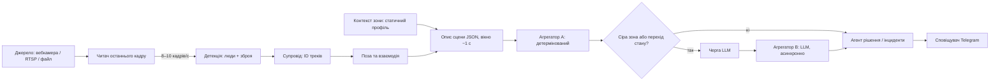
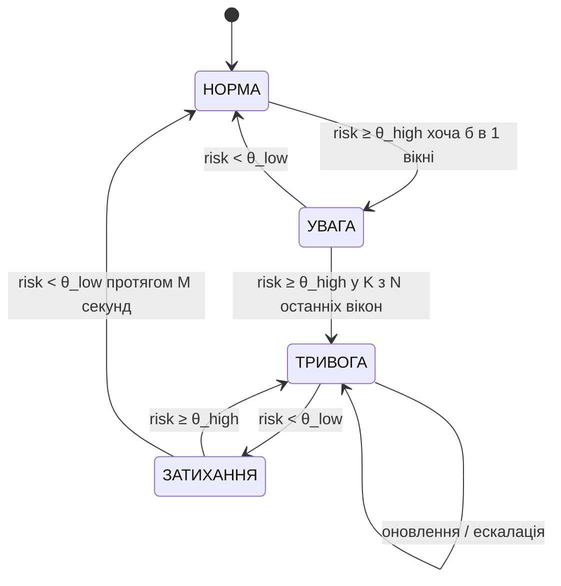

# Програмний продукт: специфікація

Версія 28.09.2026. Джерело істини для архітектурних рішень; змінюється лише за рішенням Дмитра.

Система в реальному часі аналізує відео з камери в громадському місці, оцінює рівень небезпеки для двох сценаріїв — зброя та агресивна поведінка — і надсилає оператору в Telegram одне повідомлення на інцидент із кадром і поясненням. Захист програмного продукту — Oct 12, 2026.

## Ціль, користувач і межі

**Практична ціль.** Для кожного короткого відрізка відео система відповідає на одне питання: наскільки ця ситуація небезпечна і чому. Результат — рівень тривоги (норма / увага / тривога), бал ризику від 0 до 1, причина словами та ключовий кадр як доказ.

**Користувач** — оператор відеоспостереження, який фізично не може стежити за десятками екранів. Система не замінює оператора, а відсікає нецікаве й показує лише те, що варто перевірити.

**Дослідницька ціль.** Виміряти, що саме додає мовна модель як шар ухвалення рішень порівняно з детермінованою формулою, коли обидві отримують однакові вхідні дані. Це зміст статті й наукової новизни.

**Що система свідомо не робить:**

- не розпізнає облич і не ідентифікує людей — людина для неї лише трек із номером і скелетом;
- не працює зі звуком;
- не покриває ДТП, пожежі, стихійні лиха — лише зброю та агресивну поведінку;
- **не передає в мовну модель жодного зображення** — лише текстовий структурований опис сцени;
- не приймає відео через Telegram — Telegram лише канал звітів оператору.

## Зафіксовані рішення

Усе, що ухвалено 20–26.09, в одному місці. Зміна будь-якого рядка тут — це рішення, а не деталь реалізації.

| Питання | Рішення |
| --- | --- |
| Сценарії | Зброя та агресивна поведінка. Більше нічого |
| Код бакалаврської | Пишемо з нуля. З бакалаврської беремо текст для звіту та три ідеї: журнал подій, збереження спрацювань для донавчання, конфіг у `.env` |
| Моделі | Готові: YOLO для людей, YOLO-pose для скелета, ByteTrack для трекінгу. Донавчається лише детектор зброї — або беруться готові ваги |
| Агрегація | Два агрегатори на однакових входах: детермінований (A) і LLM (B). Плюс каскад: A працює завжди, B — лише в зоні невизначеності й на переходах інциденту |
| Реальний час | Обов'язкова вимога: обробка не повільніша за відео, відставання не накопичується |
| Вхід | Камера (вебкамера чи RTSP) або відеофайл на машині, де працює система |
| Інтерфейс | Без вебсторінки. Вихід — повідомлення в Telegram із кадром і поясненням; бот приймає лише команди |
| Сповіщення | Одне повідомлення на інцидент, яке далі редагується. E-mail прибрано |
| Дані | Лише відкриті датасети з інтернету; жодних власних зйомок |
| Випробування на базі | Запуск у Docker-контейнері з чистого середовища на робочому місці практиканта (власний ноутбук; окремого сервера база не має) і прогін тестового набору там |
| Демо на захисті | Кліпи з датасетів у темпі живої камери + Telegram Desktop на проєкторі. Вебкамера підтримується, але в демо не входить |
| Фреймворки | Без LangChain, LangGraph, Streamlit. Мультиагентність — архітектурний принцип, а не бібліотека |

## 3. Логіка роботи: від кадру до сповіщення

Система працює як конвеєр із двох шарів. Нижній шар — агенти ознак: вони дивляться на кадри й пишуть у спільний структурований **опис сцени**. Верхній шар — агрегатори: вони читають лише опис сцени (жодних зображень) і повертають оцінку ризику. Агент рішення перетворює послідовність оцінок на інциденти, а сповіщувач шле їх у Telegram.



**Крок за кроком.**

1. Читач бере з джерела завжди *найсвіжіший* кадр; старі кадри відкидаються, черги кадрів немає.
2. З фіксованою частотою аналізу (≈8–10 кадрів/с, не частота камери) кадр проходить детекцію, супровід і обчислення ознак пози.
3. Раз на вікно (≈1 с) ознаки зводяться в один опис сцени: хто в кадрі, як рухається, що тримає, хто з ким взаємодіє, яка зона.
4. Агрегатор A рахує ризик **завжди** (мілісекунди): логістична регресія над ознаками. Зброя ризику A не змінює: тривогу «зброєю» відкриває спільне правило автомата інцидентів (`holds` того самого треку у двох вікнах поспіль) — однаково для A, B і каскаду (рішення 01.10).
5. Якщо ризик A у сірій зоні (≈0,35–0,65, підбирається на валідації) або агент рішення збирається змінити стан інциденту, опис сцени кладеться в чергу до агрегатора B.
6. Агрегатор B (LLM, температура 0, строгий JSON `{risk, level, reason_uk}`, кеш за хешем опису) працює у фоновому потоці й **ніколи не блокує** конвеєр. Поки відповіді немає, рішення ухвалюється за A; коли відповідь приходить — уточнює оцінку й дає пояснення українською.
7. Агент рішення веде скінченний автомат інциденту (розділ 7) і вирішує, чи відкрити, оновити, ескалювати або закрити інцидент.
8. Сповіщувач надсилає в Telegram один ключовий кадр із поясненням на інцидент і далі лише редагує це повідомлення.

**Режими агрегації** (перемикаються конфігом або командою `/mode`): `A` — лише детермінований; `B` — LLM на кожне вікно (для експерименту; у реальному часі дорого); `cascade` — основний режим, описаний вище. Для порівняння додаються два базові методи: `baseline_weapon` — детектор зброї з порогом, як у бакалаврській роботі, і `baseline_motion` — поріг на енергії руху в кадрі (класична проста евристика для агресії; рішення 30.09).

## 4. Агенти

Агент — окремий модуль із чітким входом, виходом і власною відповідальністю; агенти спілкуються лише через опис сцени та події, а не викликають нутрощі один одного. Це і є «мультиагентність» у роботі: незалежні спеціалізовані агенти ознак + два змінні агрегатори + агент рішення.

| Агент | Вхід | Вихід | Реалізація |
| --- | --- | --- | --- |
| Джерело (читач кадрів) | вебкамера, RTSP або відеофайл | найсвіжіший кадр + мітка часу | OpenCV `VideoCapture` в окремому потоці; режим `paced` для файлів (відтворення як наживо) і `offline` для експерименту |
| Детекція | кадр | рамки `person` і `weapon` з упевненістю | Ultralytics YOLO (nano): COCO-модель для людей, дотренована модель для зброї (pistol, knife) |
| Супровід | рамки по кадрах | стабільні `track_id` | ByteTrack (вбудований в Ultralytics) |
| Поза та взаємодія | треки + кадр | швидкість і прискорення зап’ясть, «тримає зброю», відстань між людьми в зростах, швидкість зближення, орієнтація одне до одного, тривалість близькості | YOLO-pose (nano), 17 ключових точок; ознаки рахуються на ковзному вікні по треку |
| Контекст зони | конфіг `zones.yaml` | тип зони, години роботи, очікувана щільність | статичний профіль; без навчання |
| Агрегатор A | опис сцени | `risk ∈ [0,1]`, рівень, коротке пояснення з правил | scikit-learn `LogisticRegression` на 17 ознаках опису сцени v3 (без ознак зброї й `facing_close`, з індикаторами відсутності) ; зброя ризику A не змінює — тривогу «зброєю» дає спільне правило автомата (рішення 30.09, 01.10) |
| Агрегатор B | опис сцени (текст) | `{risk, level, reason_uk}` | LLM `gpt-oss-120b` через OpenAI-сумісний API (Groq, запасний — Cerebras), температура 0, `reasoning_effort: low`, строгий JSON, кеш, тайм-аут; бачить `holds` в описі сцени й може враховувати зброю в ризику; у `live` при помилці — відкат на A із записом у журнал |
| Каскад | ризик A + стан FSM | чи кликати B | порогова логіка сірої зони + ліміт викликів на хвилину |
| Рішення / інциденти | потік оцінок | події `open / update / escalate / close` | скінченний автомат із гістерезисом (розділ 7) |
| Сповіщувач | події інциденту + ключовий кадр | повідомлення в Telegram | Bot API: `sendPhoto`, `editMessageCaption`, відповідь на ескалацію; команди `/mode`, `/status`, `/mute` |

**Ключові ознаки (приклади).** `limb_accel` — максимальне прискорення зап’ястя за вікно, нормоване на зріст людини (удари, розмахування); `holds` — тип зброї, якщо рамка зброї перетинається з околом зап’ястя; `distance_h` — відстань між центрами двох людей у зростах; `approach_speed` — швидкість зменшення цієї відстані; `facing` — чи повернуті обличчям одне до одного; `duration_s` — скільки триває близький контакт; `n_persons`, `crowd_motion` — кількість людей і середня швидкість руху в кадрі.

## 5. Опис сцени — спільний контракт агентів

Опис сцени — єдиний документ, через який нижній шар передає знання верхньому. Він описується моделлю pydantic (`schema.py`), серіалізується в JSON і однаково подається обом агрегаторам: A перетворює його на вектор ознак, B отримує як текст у промпті. Саме тому порівняння A і B чесне — вони бачать ті самі дані. Зображення в LLM не передаються.

```json
{
  "schema_version": 3,
  "window": {"t_start": 132.0, "t_end": 133.0, "source": "cam-1"},
  "zone": {"type": "transport_stop", "hours": "night", "expected_density": "low"},
  "summary": {"n_persons": 3, "crowd_motion": 0.42, "motion_energy": 6.3, "motion_area": 4.1, "weapon_visible": false},
  "persons": [
    {"id": 7, "speed": 0.8, "limb_speed": 1.9, "limb_accel": 14.2, "pose_motion": 0.7, "motion": 18.5, "holds": null, "conf": 0.91},
    {"id": 9, "speed": 1.4, "limb_speed": 0.6, "limb_accel": 3.1, "pose_motion": 0.3, "motion": 9.2, "holds": "knife", "conf": 0.64}
  ],
  "interactions": [
    {"pair": [7, 9], "distance_h": 0.45, "approach_speed": 1.2, "facing": true, "duration_s": 4.0}
  ]
}
```

Правила контракту:

- усі відстані й швидкості **нормовані на зріст людини в кадрі** — тоді ознаки не залежать від роздільності й відстані до камери;
- значення округлюються до 2 знаків — це робить кеш LLM дієвим і промпт коротким;
- у `interactions` лише пари ближчі за 2 зрости, до 5 пар з найменшою відстанню;
- порожня сцена (нікого немає) теж валідний опис із `n_persons: 0`. Якщо й рух у пікселях нижче τ_quiet (`motion_area` < `aggregator_a.quiet_motion_area`) — нульовий ризик без обчислень і без виклику LLM; інакше A рахує ризик з ознак руху (рішення 30.09, звіт 03);
- схема має версію (`schema_version`); зміна полів = нова версія, щоб старі результати експерименту лишалися відтворюваними;
- v3 (30.09): рух кінцівок і тіла — відносно середини плечей, по згладжених траєкторіях ключових точок (`limb_speed`, `limb_accel`, `pose_motion`, зрости/с і зрости/с²); рух у пікселях, незалежний від детекції людей (`motion_energy` — середня абсолютна різниця сусідніх кадрів аналізу в рівнях сірого, `motion_area` — % пікселів зі зміною понад поріг, `motion` особи — різниця в її рамці).
- сприйняття 3.1 (30.09): рух у пікселях нормується на Δt до номінального інтервалу аналізу 1/fps — у `live` / `paced` з пропуском кадрів значення ті самі, що в офлайн-кеші; кадри на номінальній сітці дають рівно значення 3.0, тож кеш 3.0 чинний.

## 6. Реальний час

Система вважається такою, що працює в реальному часі, якщо обробка не відстає від відео: одна секунда відео обробляється не довше ніж за одну секунду, а затримка від події до сповіщення вимірювана й обмежена. Відставання не накопичується, бо кадри не ставляться в чергу.

**Як це забезпечується**

1. **Фіксована частота аналізу**, а не частота камери: 8–10 кадрів/с достатньо, щоб побачити удар чи витягнуту зброю. Камера може давати 25–30 кадрів/с — зайві пропускаються.
2. **Читач останнього кадру**: окремий потік постійно зчитує камеру й тримає лише один найсвіжіший кадр. Якщо аналіз забарився, старі кадри просто втрачаються, а не накопичуються.
3. **Легкі моделі**: nano-версії YOLO на CPU; якщо не встигаємо — зменшуємо розмір входу (640 → 480 → 416) або рідше запускаємо детектор зброї (через кадр), залишаючи позу щокадровою. За заміром 28.09 обрано (29.09): YOLO26n для людей і пози, `imgsz` 480, 10 кадрів/с; з 30.09 люди — YOLO11n detect (правило «≥ 95 % людей»), поза — YOLO26n-pose. Бекенд моделей — `models.backend` (`torch` | `openvino`); OpenVINO — залежність з 30.09, експорт лише командою `sentinel export`; дефолтний бекенд — `openvino` (тихий замір 30.09: RTF@10 0,54 для дефолтної конфігурації).
4. **LLM поза критичним шляхом**: B працює у фоні з чергою довжиною 1–2 (новіша сцена витісняє старішу), тайм-аут 8 с; конвеєр ніколи не чекає на відповідь.
5. **Режими джерела**: `live` (камера), `paced` (файл відтворюється з реальною швидкістю — для демонстрації), `offline` (файл без пауз — для експерименту на наборах даних; тут реальний час не потрібен, потрібна швидкість).
6. **Живлення**: демонстрація й випробування — лише від мережі, профіль `performance` (на батареї обробка приблизно вдвічі повільніша). `sentinel bench` записує джерело живлення й профіль у кожен рядок і не змішує такі прогони.

**Що вимірюємо і записуємо в журнал**

| Метрика | Визначення | Ціль |
| --- | --- | --- |
| RTF (real-time factor) | час обробки / тривалість відео | ≤ 1,0 на машині демонстрації |
| Ефективна частота аналізу | оброблено кадрів за секунду | ≥ 8 кадрів/с |
| Частка пропущених кадрів | пропущені / отримані від камери | фіксується, не цільова |
| Затримка до тривоги | час від початку події (за розміткою) до відкриття інциденту | медіана ≤ 3 с для режиму A |
| Затримка LLM | від постановки в чергу до відповіді | фіксується; p95 ≤ 8 с |

Перше, що робимо в коді, — замір RTF на машині, де буде демонстрація; від нього залежать розмір входу й частота детектора зброї.

## 7. Інциденти й сповіщення в Telegram

Головна вимога: одна бійка — **одне повідомлення**, а не повідомлення щосекунди. Для цього оцінки ризику по вікнах перетворюються на інциденти скінченним автоматом.



**Правила автомата.** Поріг відкриття θ\_high вищий за поріг закриття θ\_low (гістерезис), тому ризик, що коливається біля порога, не відкриває й не закриває інцидент щосекунди. Початкові значення: θ\_high = 0,6; θ\_low = 0,4; K = 3 з N = 5 вікон; M = 10 с; зброя в руці того самого треку у двох вікнах поспіль відкриває ТРИВОГУ одразу, без K з N, і це правило однакове для A, B і каскаду (ризик агрегатора від зброї не залежить; повідомлення першою фразою називає зброю; рішення 01.10) (рамки зброї, вищі за 0,5 зросту людини, відкидаються як неправдоподібні; рішення 30.09). Остаточні значення підбираються на валідаційній частині даних: θ\_high = 0,71 — 95-й процентиль ризику спокійних вікон нашого val RWF (A v1); θ\_low = 0,65 і M = 5 с — на склейках кліпів val, де інцидент має закритися не пізніше M + 5 с після кінця бійки й не мерехтіти (`sentinel eval fsm-tune`, рішення 30.09).

**Правила Telegram**

- **Відкриття**: `sendPhoto` — ключовий кадр (кадр з максимальним ризиком за перші вікна) з рамками, підпис: рівень, час, камера, пояснення українською (від B, якщо вже є, інакше з правил A).
- **Поки інцидент триває**: лише `editMessageCaption` того самого повідомлення не частіше ніж раз на 10 с — тривалість, максимальний ризик, кількість учасників.
- **Ескалація** (наприклад, під час бійки з’явилася зброя): окрема відповідь (reply) на повідомлення інциденту з новим кадром — щоб прийшло push-сповіщення.
- **Закриття**: фінальне редагування підпису «завершено, тривалість N с».
- **Дублікати**: якщо новий інцидент тієї ж камери з перетином учасників або в межах 30 с після закриття попереднього — він приєднується до старого, а не відкриває новий (трекер міг загубити й перенумерувати людей).
- **Глобальний ліміт**: не більше \~6 нових інцидентів на хвилину на чат; решта агрегуються в одне зведене повідомлення.
- **Команди бота** (читаються через `getUpdates`, лише від дозволених chat\_id): `/mode A|B|cascade`, `/status` (RTF, частота, режим, відкриті інциденти), `/mute 10m`.
- Відео через Telegram не приймається й не надсилається — лише кадри й текст.

**Приватність.** Кадри з людьми проходять через сервери Telegram; у звіті й дисертації це зазначається як обмеження, а в конфігурації є опція розмивати обличчя на надісланому кадрі.

## 8. Вимоги

**Функціональні**

| № | Вимога |
| --- | --- |
| Ф1 | Приймати відео з вебкамери, RTSP-потоку або відеофайлу; джерело задається в конфігурації або параметром CLI |
| Ф2 | Виявляти людей і зброю (пістолет, ніж) на кадрі та супроводжувати людей між кадрами зі сталими ідентифікаторами |
| Ф3 | Обчислювати ознаки пози й взаємодії та формувати опис сцени раз на вікно (\~1 с) за схемою з розділу 5 |
| Ф4 | Оцінювати ризик трьома способами (A, B, каскад) і базовим методом; режим перемикається без перезапуску |
| Ф5 | Формувати інциденти за автоматом із розділу 7 без дублювання повідомлень про одну подію |
| Ф6 | Надсилати в Telegram ключовий кадр із поясненням українською, оновлювати й закривати повідомлення інциденту |
| Ф7 | Приймати команди `/mode`, `/status`, `/mute` лише від дозволених чатів |
| Ф8 | Записувати журнал: опис сцени, ризик A/B, рішення, затримки — у JSONL для подальшого аналізу |
| Ф9 | Запускати експеримент одною командою: усі конфігурації на тих самих епізодах → таблиця метрик і графіки |

**Нефункціональні**

| № | Вимога |
| --- | --- |
| Н1 | RTF ≤ 1 на машині демонстрації без GPU при частоті аналізу ≥ 8 кадрів/с |
| Н2 | Недоступність LLM або Telegram не зупиняє конвеєр: B відкочується на A, повідомлення ставляться в повтор |
| Н3 | Відтворюваність: фіксовані seed, версія схеми, закешовані відповіді LLM зберігаються разом із результатами |
| Н4 | Секрети (токен бота, ключ LLM) — лише у `.env`, не в репозиторії |
| Н5 | Запуск одною командою через Docker на будь-якій машині з Docker (для випробувань — ноутбук практиканта) |
| Н6 | Мінімум залежностей; код покритий модульними тестами для схеми, ознак, агрегатора A, автомата інцидентів |
| Н7 | Обмеження ліцензій наборів даних (лише для досліджень) дотримано й зазначено в звіті |

## 9. Дані та експеримент

Усі дані беруться з відкритих джерел; власних записів немає. У звіті це подається як підрозділ «Обґрунтування вибору наборів даних» із порівняльною таблицею кандидатів.

| Набір | Що дає | Розмітка | Роль у роботі |
| --- | --- | --- | --- |
| [RWF-2000](https://arxiv.org/abs/1911.05913) | 2000 кліпів по 5 с із камер спостереження, бійка / не бійка | на рівні кліпу | основний для агресії: навчання A, тест усіх конфігурацій |
| [XD-Violence](https://roc-ng.github.io/XD-Violence/) (дзеркало на Kaggle) | довгі відео, класи Fighting, Shooting | покадрова для тесту | лише тест: довгі відео, затримка до тривоги, хибні тривоги на нормі; Shooting (B2) — відеосценарій «зброя» (фільми / YouTube, не CCTV) |
| [US Real-time gun detection in CCTV](https://github.com/Deepknowledge-US/US-Real-time-gun-detection-in-CCTV-An-open-problem-dataset) (Севільський університет) | кадри з трьох камер CCTV зі зброєю, розмічені з частотою 2 кадри/с (відеофайлів у наборі немає) | рамки зброї | покадрово, поділ за камерами: Cam1 + Cam5 — вибір ваг і порогу детектора зброї; Cam7 — відкладений тест (його послідовності кадрів — епізоди сценарію «зброя») |
| Набори зброї на Kaggle / Roboflow + готові ваги YOLOv8 з GitHub | зображення пістолетів і ножів | рамки | дотренування детектора зброї (Kaggle GPU), якщо готових ваг замало |

**Епізоди.** Кожне відео ріжеться на епізоди з міткою «небезпечно / норма» (для XD-Violence — ще й момент початку події). Поділ: навчання / валідація / тест за відео, без перетину. RWF-2000: оригінальний `val` (400 кліпів) — тест; оригінальний `train` (1600) → навчання / валідація 80/20 цілими вихідними роликами, стратифіковано за класом, фіксований seed (`data/splits/rwf2000.json`). XD-Violence — лише тест. Севілья — поділ за камерами (`data/splits/us_gun.json`). На навчальній частині тренується логістична регресія A, на валідаційній — пороги θ, межі сірої зони, K з N; тест використовується один раз.

**Конфігурації (однакові епізоди, однакові ознаки)** — усі читають той самий кеш описів сцени (`data/episodes/`, один прогін сприйняття на епізод; рішення 30.09)

1. `baseline_weapon` — детектор зброї з порогом у вікні, як у бакалаврській роботі (без пози й підтвердження);
2. `baseline_motion` — поріг на енергії руху в кадрі (`motion_energy`), проста евристика для агресії;
3. `A` — детермінований агрегатор;
4. `B` — LLM-агрегатор на кожне вікно;
5. `cascade` — A завжди, B лише в сірій зоні.

**Метрики**: F1 на рівні епізоду, ROC-AUC, частка хибних тривог (FPR) на нормальних відео, затримка до тривоги, RTF, частка вікон, що пішли в LLM, вартість на годину відео. Для B додатково — узгодженість відповіді при повторі (чи дає той самий опис той самий ризик) і якість пояснень на вибірці (ручна оцінка 30–50 випадків).

**Гіпотеза для перевірки**: каскад дає якість, близьку до B, за вартості й затримки, близьких до A.

## 10. Структура репозиторію та залежності

```text
sentinel/
├── README.md
├── CLAUDE.md                  # правила для Claude Code в терміналі
├── pyproject.toml
├── .env.example               # TELEGRAM_TOKEN, TELEGRAM_CHAT_IDS, GROQ_API_KEY, CEREBRAS_API_KEY
├── configs/
│   ├── default.yaml           # частота аналізу, пороги, режим, розмір входу
│   ├── bytetrack.yaml         # налаштування трекера (копія з Ultralytics, версіоноване з проєктом)
│   └── zones.yaml             # профілі зон
├── data/
│   ├── SOURCES.md             # джерела, умови, розміри, хеші наборів і ваг
│   └── splits/                # поділи наборів (у git)
├── docs/
│   ├── SPEC.md
│   ├── DECISIONS.md           # журнал рішень
│   ├── prompts/               # завдання на сесії
│   ├── reports/               # звіти сесій
│   └── bench/                 # звіти замірів
├── src/sentinel/
│   ├── config.py
│   ├── schema.py              # pydantic: SceneDescription, Person, Interaction, RiskResult
│   ├── io/source.py           # LatestFrameReader: live / paced / offline
│   ├── agents/
│   │   ├── detector.py        # люди + зброя, трекінг
│   │   ├── pose_features.py   # поза, ознаки особи й пари
│   │   └── context.py         # профіль зони
│   ├── aggregators/
│   │   ├── rules.py           # A: логістична регресія + правило зброї
│   │   ├── llm.py             # B: промпт, строгий JSON, кеш, тайм-аут
│   │   └── cascade.py         # сіра зона, асинхронний воркер
│   ├── incidents.py           # автомат інцидентів
│   ├── notify/telegram.py     # sendPhoto / editMessageCaption / команди
│   ├── pipeline.py            # складає все в конвеєр, метрики реального часу
│   ├── bench.py               # замір швидкості: мс/кадр, RTF, реальний час (paced)
│   ├── models.py              # ваги за бекендом: .pt або експорт OpenVINO (sentinel export)
│   ├── cli.py                 # run / eval / bench / export
│   └── eval/                  # `sentinel eval <команда>` (рішення 30.09: у пакеті, а не на верхньому рівні)
│       ├── build_episodes.py  # датасети → поділи
│       ├── extract.py         # епізоди → кеш описів сцени (data/episodes/)
│       ├── run_experiment.py  # конфігурації → results/*.jsonl
│       └── metrics.py         # F1, ROC-AUC, FPR, затримка, RTF, графіки
├── notebooks/train_weapon_detector.ipynb   # для Kaggle GPU
├── tests/
└── Dockerfile
```

**Залежності**: `ultralytics` (тягне numpy, opencv, requests, pyyaml), `pydantic`, `scikit-learn`, `python-dotenv`, `lap` (потрібен трекеру ByteTrack в Ultralytics), `openvino` (з 30.09). Telegram — прямі HTTP-запити через `requests`, без окремої бібліотеки. LLM — через HTTP API (OpenAI-сумісний endpoint, `requests`): модель `gpt-oss-120b` (відкриті ваги — відтворюваність), основний провайдер Groq, запасний для розробки — Cerebras; `base_url`, точний ідентифікатор моделі й ліміти — у `configs/default.yaml → llm.providers`, ключі `GROQ_API_KEY`, `CEREBRAS_API_KEY` — у `.env`; `reasoning_effort: low` (рішення 01.10; Gemini з плану прибрано). Без Streamlit, LangChain, LangGraph.

**Команди**: `sentinel run --source 0` (вебкамера), `sentinel run --source video.mp4 --paced` (демонстрація), `sentinel bench --source video.mp4` (замір RTF), `sentinel export` (моделі → OpenVINO), `sentinel eval <команда>` (поділи, кеш описів сцени, навчання, експеримент).

## 11. План реалізації до захисту програмного продукту (12.10)

План узгоджений із пунктами 5.3–5.5 індивідуального завдання. Кожен етап закінчується робочим результатом, який можна показати, тож навіть урізана версія готова до демонстрації.

| Дати | Що робимо | Результат (критерій готовності) |
| --- | --- | --- |
| 26–28.09 | Каркас репозиторію, `schema.py`, читач кадрів, детекція + трекінг + поза; `sentinel bench` | відомий RTF на машині демонстрації; обрано розмір входу |
| 29.09–01.10 | Ознаки особи й пари, опис сцени, агрегатор A (спершу ручні ваги), автомат інцидентів, Telegram | відео з бійкою → одне повідомлення в Telegram, яке оновлюється й закривається |
| 02–04.10 | Завантаження наборів, `build_episodes.py`, поділ; baseline; готові ваги зброї або донавчання на Kaggle; навчання логістичної регресії A | епізоди готові, A навчений, перші цифри A проти baseline |
| 05–07.10 | Агрегатор B (промпт, JSON, кеш, тайм-аут), асинхронний воркер, каскад, команди бота | усі чотири режими працюють в `run` і `eval`; RTF ≤ 1 з увімкненим каскадом |
| 08–10.10 | Повний експеримент, підбір порогів на валідації, таблиці й графіки; тести | таблиця метрик для звіту й статті |
| 11.10 | Docker-образ, запуск у контейнері з чистого середовища, репетиція демонстрації | сценарій демо: вебкамера + 2–3 відео у режимі `paced`, повідомлення на телефоні |
| 12.10 | Захист програмного продукту | — |
| 12–13.10 | Комплексне тестування, випробування в умовах бази (прогін тестової частини в Docker-контейнері на робочому ноутбуці) | протокол випробувань для звіту |

**Що ріжемо, якщо не встигаємо** (в такому порядку): донавчання детектора зброї (беремо готові ваги) → XD-Violence (лише RWF-2000 + Севілья) → команди бота → ручна оцінка пояснень LLM (переносимо в дисертацію). Агрегатори A і B, каскад, інциденти й Telegram не ріжуться — це ядро новизни.

## 12. Відкриті питання та джерела

**Обмеження новизни.** Мультиагентні та LLM-підходи до виявлення аномалій у відео вже існують, тому формулювання «вперше» не використовуємо. Новизна роботи — кероване порівняння детермінованої та LLM-агрегації на ідентичному структурованому описі сцени та каскадна схема, що поєднує їхні переваги в реальному часі.

**Джерела**

- Cheng M., Cai K., Li M. RWF-2000: An Open Large Scale Video Database for Violence Detection. arXiv, 2019. https://arxiv.org/abs/1911.05913
- Wu P. et al. Not only Look, but also Listen: Learning Multimodal Violence Detection under Weak Supervision (XD-Violence). ECCV, 2020. https://roc-ng.github.io/XD-Violence/
- Deepknowledge-US. Real-time gun detection in CCTV: An open problem (dataset). https://github.com/Deepknowledge-US/US-Real-time-gun-detection-in-CCTV-An-open-problem-dataset
- Thakur A. et al. Real-Time Weapon Detection Using YOLOv8 for Enhanced Safety. arXiv, 2024. https://doi.org/10.48550/arXiv.2410.19862
- Zhang Y. et al. ByteTrack: Multi-Object Tracking by Associating Every Detection Box. ECCV, 2022. https://arxiv.org/abs/2110.06864
- Ye M. et al. VERA: Explainable Video Anomaly Detection via Verbalized Learning of Vision-Language Models. CVPR, 2025. https://arxiv.org/abs/2412.01095
- Ultralytics YOLO: документація (detect, pose, track). https://docs.ultralytics.com
- Telegram Bot API. https://core.telegram.org/bots/api
